<p align="center">
  
</p>

<h1 align="center">Localport</h1>

<p align="center"><strong>Secure tunnels and remote access by identity.</strong></p>

<p align="center">
  <a href="https://github.com/localport/agent/actions/workflows/ci.yml"></a>
  <a href="https://github.com/localport/agent/actions/workflows/codeql.yml"></a>
  <a href="https://github.com/localport/agent/releases"></a>
  <a href="https://github.com/localport/agent/blob/main/go.mod"></a>
  <a href="LICENSE"></a>
  <a href="https://localport.io/docs"></a>
</p>

Localport publishes services over secure tunnels and gives identity-based remote access to devices. Tunnels serve HTTP, TCP, and TLS at a public address, with automatic HTTPS for HTTP tunnels and access checks such as IP allow lists, passwords, and webhook signature verification. Fleet devices have no public address and are reached by client certificate over mutual TLS. Both work through NAT, CGNAT, and corporate firewalls without port forwarding, router configuration, or a public IP.

An HTTP tunnel can also switch to fanout delivery, which gives a whole team one permanent URL. Each request, such as a webhook, reaches every teammate's agent, and one designated client returns the response.

This repository contains the Localport agent, the client process that runs on the host machine and maintains tunnel connections to the Localport network. The agent is the only component that runs in your environment, and it is released as open source under the Apache License 2.0. The remainder of the platform, including the edge network, control plane, and dashboard, is operated by Localport as a managed service.

Accounts and tunnels are managed at [localport.io](https://localport.io).

<p align="center">
  
</p>

## Features

- **Protocols.** HTTP, TCP, and TLS tunnels with automatic, browser-trusted HTTPS.
- **Reserved addresses.** Subdomains and reserved ports persist across sessions, keeping public links and webhook URLs stable.
- **Remote access.** A fleet is a group of devices, each enrolled once with its own single-use join token. Each device receives its own address, remains reachable by name behind CGNAT or cellular networks, and serves the ports allowed for it in the dashboard. A fleet has no public endpoint. Consumers reach a device with `localport access <device> -L <local>:<remote>` over one mutual TLS connection, presenting a client certificate.
- **Fanout tunnels.** One permanent URL for the whole team. Each inbound HTTP request is delivered to every connected client and a designated client returns the response, so every developer receives the same webhooks without registering an endpoint of their own.
- **Scoped access.** Each certificate names a stable identity. What an identity may reach is managed server-side and can be changed without reissuing certificates, and narrowing a grant or revoking a certificate closes live connections. Bring your own certificate authority if you prefer, since only its public chain is stored.
- **Self-renewing credentials.** `localport setup <TOKEN>` redeems a single-use token, generates its private key locally, and renews itself from then on. No certificate file to copy around and no long-lived secret on the machine.
- **Sign in as yourself.** `localport login` prints a short code, you approve it in the dashboard in any browser, and a short-lived certificate lands on this machine. It works over SSH into a jump box. A sign-in lasts hours and does not renew; run `localport login` again. Removing the person from the team ends their access.
- **CI with no secret.** In a pipeline the agent exchanges the platform's workload identity (GitHub Actions out of the box) for a short-lived certificate held in memory. Nothing is stored in the repository, the CI secret store, or on the runner.
- **Access control.** IP allow lists on every tunnel. HTTP tunnels can also require a password, required request headers, or a verified webhook signature (GitHub, Stripe, Shopify, Slack, or HMAC-SHA256), checked on every request. Fleets are reached by client certificate.
- **Data privacy.** Traffic is never inspected, logged, or used for training, and each tunnel is pinned to a chosen region.
- **Cross-platform.** Signed releases for macOS 13 or later, Linux with kernel 3.2 or later (including 32-bit ARM), and Windows 10 or later, as binaries, apt/dnf/apk packages, and a container image.

## Installation

```sh
# macOS and Linux (Homebrew)
brew install localport/tap/localport

# macOS and Linux (install script)
curl -fsSL https://localport.io/install.sh | sh
```

```powershell
# Windows (PowerShell)
irm https://localport.io/install.ps1 | iex
```

```sh
# Container image (linux/amd64, linux/arm64, linux/arm/v7)
docker run --rm ghcr.io/localport/agent:latest version
```

On Debian, Ubuntu, RHEL, Rocky Linux, Amazon Linux, Fedora and Alpine, the install script sets up the signed package repository at `pkg.localport.io`, so upgrades come through `apt`, `dnf` or `apk`. Manual repository setup, direct downloads from the [releases page](https://github.com/localport/agent/releases), and platform-specific notes are in the [installation guide](https://localport.io/docs/installation).

Every release is signed and carries SLSA build provenance and an SBOM. [SECURITY.md](SECURITY.md) shows how to verify one, and [RELEASING.md](RELEASING.md) describes how releases are built and signed.

## Usage

Create a tunnel in the [dashboard](https://dashboard.localport.io) to obtain its token, or create a fleet device to obtain its join command, then run the agent:

```sh
# Publish a local service
localport http 3000 -t <token>

# Enrol this machine as a fleet device with the join token the dashboard shows,
# and install the device service that runs it at boot
sudo localport connect <join-token> --enable terminal,files --logins pi

# A device serving another machine, limited to these ports
sudo localport connect <join-token> --host 192.168.1.100 --allow-ports 502,8000-8100

# Change what a device allows; the device service reloads to apply it
# (only that device restarts, and its open sessions end)
sudo localport set plc-01 --enable terminal,files,desktop --vnc

# Install the device service again for the enrolled devices, without a join token
sudo localport service install

# Stop and remove the device service (--purge also deletes the config, device credentials and recording spool)
sudo localport service uninstall

# Reach that device's ports
localport access plc-01-factory.ap.localport.dev -L 5020:502 -L 8080:80

# Run several tunnels from one file
localport connect --config localport.yaml
```

Device service:

- As root (an elevated Administrator on Windows), `connect` installs and starts the device service: on Linux the systemd unit `localport-device.service`, or the OpenRC or OpenWrt procd service `localport-device`; on macOS the launchd daemon `io.localport.device`; on Windows the service `localport-device`. It runs `localport run --service`, which serves every device in the machine-wide local config. `--foreground` runs the devices in the terminal instead: as root on Linux and macOS every device in the machine-wide config, through `run --system` as the `localport` account (`--no-mux` is not available there); without root the device always runs in the foreground.
- On Linux and macOS the agent runs as the system account `localport`, which `connect` and `service install` create (the OpenWrt package creates it). The systemd unit adds `NoNewPrivileges`, an empty capability set, `ProtectSystem=strict` with write access only to the identity directory and `run.lock`, `ProtectHome`, `PrivateTmp`, `PrivateDevices` and a system call filter. A root session launcher, `localport-session` (systemd `localport-session.socket`, launchd `io.localport.session`, OpenRC and procd `localport-session`), starts each terminal session; the agent reaches it over `/run/localport/session.sock` (`/var/run/localport/session.sock` on macOS), which only the `localport` group can open.
- On Windows the service runs as the virtual account `NT SERVICE\localport-device`, whose token holds only `SeChangeNotifyPrivilege`.
- Files on Linux and macOS: the device directory (`/etc/localport-device`, `/Library/Application Support/localport-device`) is root:localport 0750; `agent.yaml` is root:localport 0640 and only root changes it; `identity/` (credentials, ticket keys, the recording spool `identity/recordings/`) belongs to `localport` with mode 0700. Root never opens a file inside `identity/`: `sudo localport status`, `identity`, `login`, `setup`, `access`, `run` and the enrolment step of `connect` run as `localport`. An install that ran the agent as root is converted in place by the next `sudo localport connect` or `sudo localport service install`; its tunnels keep working.
- `localport status` shows the service state; root and members of group `localport` also see the devices, whether sessions use PAM, and on macOS whether the launcher has Full Disk Access; root also sees each device's key fingerprint.
- One process serves the devices. A second privileged `run` or `connect --foreground` is refused at once, naming the device service when it is installed. A restarting service waits up to 30 s for the previous process to exit, then exits with status 3.
- The service manager starts the `localport` and `localport-session` binaries as root (`localport-session` keeps root; `localport` runs as the account on Linux and macOS), so only root (SYSTEM, Administrators or TrustedInstaller on Windows) may be able to replace them. Install it with the install script as root (`/usr/local/bin`, or `/opt/localport/bin` when `/usr/local/bin` is not root-owned) or an elevated `install.ps1` (`%ProgramFiles%\Localport`), and call it by that absolute path, such as `sudo /usr/local/bin/localport connect <join-token>`. A Homebrew, Scoop, winget or user-profile install cannot run the device service. Every privileged `run` repeats this check at start, so a service whose binary changed owner keeps restarting with the reason in its log.
- Before spending the join token, `connect` refuses a service definition under the service's name that it did not write (systemd drop-ins are accepted and listed), another process serving the devices, and a binary that fails the check above.
- When the install fails after enrolment, `sudo localport service install` installs the service without a new join token.
- `service uninstall` stops and removes the service and the session launcher, and keeps the devices and the recording spool. `--purge` also deletes `agent.yaml`, the device credentials under `identity/` and the recording spool (`identity/recordings/`, `recordings\` on Windows); machine credentials from `setup` stay. On Windows, while a tool holds a deleted service open, install and purge refuse with `AG044` until that tool closes or Windows restarts.
- Logs: the systemd journal, the OpenWrt system log, and the Event Log source `localport-device` on Windows. Under launchd and OpenRC the agent writes `/var/log/localport/device.log` and the launcher `/var/log/localport-session.log`, each rotated by the process itself.

Terminal sessions (Linux and macOS):

- The agent hands each terminal session to the root launcher, which checks the request against the root-owned `agent.yaml` (the device must enable the terminal and list the login) and starts a helper, `localport-session helper`, for it. The helper runs the PAM service `localport` (installed by the packages in `/etc/pam.d/localport`): account checks, credentials and the session, so `pam_systemd`, `pam_selinux`, `pam_loginuid` and `pam_limits` apply. It takes the account and its groups from the system's account database, the environment from PAM and `/etc/login.defs`, writes utmp and wtmp, opens the pseudo-terminal and starts the login's shell.
- On hosts without PAM (Alpine without linux-pam, OpenWrt, Yocto without PAM) the helper applies the checks sshd applies without PAM: the account exists, is not locked (`!` in the shadow file) or expired, and has an existing, executable shell. `localport status` and the dashboard show "no PAM".
- Where no usable login exists, `run_as_agent: true` in a device's `agent.yaml` entry runs its sessions as the `localport` account, without PAM; the dashboard shows it.
- An agent running as a user (`connect --foreground` or `run` without root) serves only its own user.
- `exit` reports the shell's status.
- A session ends with SIGHUP to its shell and its terminal; 5 s later the helper sends SIGKILL to the session. The helper is the shell's parent and does not reap it before then, so the shell's pid cannot be reused for that signal. Without pidfd (Linux before 5.3) and on macOS the terminal's session leader, when it is not the shell, is signalled by pid, so a pid reused within the 5 s window can receive the SIGKILL. A reconnect of the session mux, like the agent stopping, ends every session; a session also ends when its device's settings change (`config_changed`), when the helper fails (`helper_failed`), or when the launcher cannot be reached after the ticket was spent (`launcher_unavailable`).
- Sessions are children of the launcher, whose stop or restart leaves them running (systemd `KillMode=process`; OpenWrt procd ends them when the launcher is stopped, not when it restarts in place). A process started in a session that ignores SIGHUP survives in its logind session scope (with `pam_systemd`).
- On macOS, Full Disk Access for the launcher (`localport-session`) is opt-in, granted in System Settings or by a configuration profile.
- `sudo localport service install`, `sudo localport service uninstall` and a `sudo localport connect` that installs the service (not `--foreground`) run from a terminal session ignore SIGHUP and SIGPIPE, so ending the session they restart or stop does not stop them halfway, and they write their outcome to the system log under the tag `localport`. The `connect` record names only the command and whether it completed or failed, never the join token. Runs without root write no record, and a host with no system log daemon listening gets none.

Session recording (terminal sessions, set by the team's recording policy):

- A recorded session's ticket names the policy.
- The agent encrypts the recording on the device under a key of its own, wrapped to the team's recording key, and uploads it in segments over the session mux. It never holds the team's private key, so it cannot decrypt other recordings. It clears its copy of a recording's key when the recording ends; copies inside the cipher and the Go runtime stay in process memory until the runtime reuses it.
- `best_effort`: the session starts at once. When the agent cannot deliver or store the recording, recording stops, the recording is marked incomplete, and the session continues.
- `strict`: the agent opens the recording before it accepts the session, and refuses the session with the retryable `recording_unavailable`, before any shell starts, when it cannot. A session whose recording can no longer be kept ends with the close reason `recording_failed`.
- A segment not acknowledged within 5 s, or produced while the agent is offline, is kept in the spool `<state root>/recordings/` (the directory that holds `identity/`: the machine-wide config directory for the device service, `$LOCALPORT_HOME` or `~/.localport` for a manual run as a user) until it is uploaded. The spool holds at most 32 MiB in total and stops taking writes when its filesystem has under 64 MiB free. An agent restart resumes the uploads; an entry older than 24 h, or of a device no longer in the local config, is deleted.

The machine-wide config directory (`/etc/localport-device`, `/Library/Application Support/localport-device` or `%ProgramData%\localport-device`) holds `agent.yaml`, under `identity/` each device's private key, and under `recordings/` the recording spool. Keep it out of backups and configuration management.

Security notes:

- `--allow-ports` is the only port limit enforced on the device. Without it the agent serves any port the dashboard allows on that host. Plain mode (`--noui` or no TTY) logs a warning at startup and the TUI shows `Limit  none` in the device header.
- `localport access -L` listens on 127.0.0.1, so any local user can use the forward with your identity, as with `ssh -L`. Avoid `--local-addr 0.0.0.0` on shared hosts. Use a `0600` Unix socket instead, `-L unix:/run/user/1000/plc.sock:502` (not on Windows).
- `${VAR}` in a config file is expanded from the environment before parsing, so a config can send any environment variable to Localport. Only run trusted config files.

Complete command, flag, configuration, and protocol documentation is maintained on the documentation site:

- [Quick start](https://localport.io/docs/quick-start): first-tunnel walkthrough
- [CLI reference](https://localport.io/docs/cli): commands, flags, and environment variables
- Tunnel guides, by protocol ([HTTP](https://localport.io/docs/http-tunnels), [TCP](https://localport.io/docs/tcp-tunnels), TLS) and delivery mode ([fanout](https://localport.io/docs/fanout))
- Remote access guides ([fleets](https://localport.io/docs/fleets), [`localport access`](https://localport.io/docs/remote-access))

## Build from source

Requires Go 1.27 or newer.

```sh
git clone https://github.com/localport/agent.git
cd agent
make build
./bin/localport version
```

`make build-all` cross-compiles every release platform into `bin/`.

## Documentation

- Product and guides: [localport.io/docs](https://localport.io/docs)
- Wire protocol: [docs/PROTOCOL.md](docs/PROTOCOL.md)
- Error codes (`[AG###]`) and what to do: [docs/ERRORS.md](docs/ERRORS.md)

## How it works

- **Single port.** Every agent and consumer connection goes to the edge on 443. The edge routes by SNI and ALPN, so any network that allows HTTPS allows Localport.
- **Firewall traversal.** The agent tries raw TLS first and falls back to WebSocket, which passes deep packet inspection and TLS-intercepting proxies.
- **Multiplexing.** Each tunnel holds one control connection and one HTTP/2 connection carrying a stream per visitor. If the HTTP/2 connection is unavailable, the agent dials back once per visitor.
- **Network changes.** The agent watches interfaces and detects wake from sleep. After either, it probes the edge and reconnects within seconds when the old connection is gone.
- **Remote access.** `localport access` holds one mutual TLS HTTP/2 connection per device and opens a CONNECT stream per forward. The edge checks the certificate and grant before a stream reaches the device.
- **Sessions.** A device that enables `terminal`, `files` or `desktop` holds a second HTTP/2 connection for browser and CLI sessions. The agent verifies each session ticket itself (signature, expiry, single use, device binding), applies its local `enable` and `logins`, and runs an end-to-end encrypted channel the edge cannot read. At most 8 sessions run at once; a session idle for 30 minutes is closed. A `terminal` session is a login shell for the ticket's login (see Terminal sessions above).
- **TLS 1.3 everywhere.** Tunnel, consumer, and control-plane connections all require TLS 1.3. Private keys are generated on the machine and never leave it.

## Contributing

Issues and pull requests are welcome. For non-trivial changes, open an issue to discuss the approach before submitting. Run `make test`, `make vet`, and `make lint` before opening a pull request. `sudo LOCALPORT_TEST_LOGIN=<account> make test-root` runs the tests that need root: a real PAM terminal session started by the session helper for that test account, which needs `/bin/sh` as its shell and the `localport` PAM service file installed (`packaging/pam/`).

## Security

Report vulnerabilities privately, as described in [SECURITY.md](SECURITY.md). Do not open public issues for security reports.

## License

Apache License 2.0. See [LICENSE](LICENSE) and [NOTICE](NOTICE).

The agent bundles open-source dependencies under permissive licenses (BSD, ISC,
Apache-2.0); their notices are reproduced in
[THIRD_PARTY_NOTICES](THIRD_PARTY_NOTICES), regenerated from the module graph by
`make notices`.
